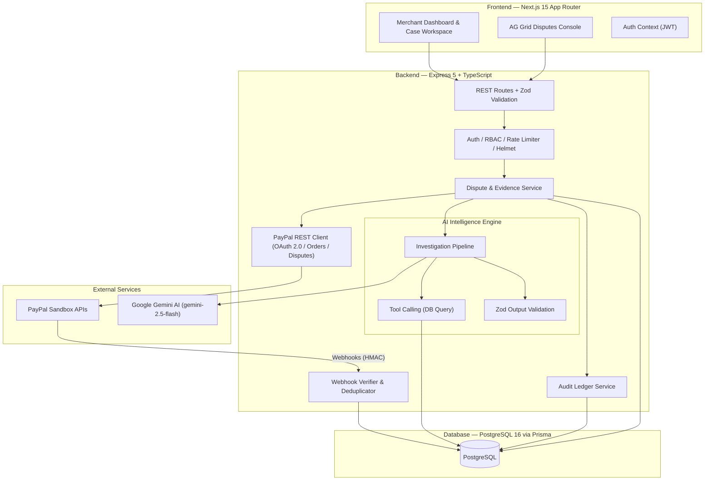

# 🛡️ ResolveAI

**AI-Powered Dispute Investigation & Evidence Intelligence Platform for PayPal Merchants**

> Built for the **PayPal AI Hackathon 2026** on Devpost

[](LICENSE)
[](https://developer.paypal.com)
[](https://ai.google.dev)
[](https://www.postgresql.org/)
[](https://www.ag-grid.com/)
[](https://render.com)

---

## 🎯 Problem

Online merchants lose over **$125 Billion annually** to payment disputes and chargebacks. When a customer lodges a dispute (Item Not Received, Unauthorized Transaction, or Item Not as Described):
- Merchants must manually scour multiple systems to gather order records, carrier tracking details, and customer messages.
- Merchants lack objective, data-driven benchmarks to know if their evidence meets PayPal's **Seller Protection** criteria.
- Tight deadlines (often under 7–10 days) mean incomplete or late contestations are forfeited automatically.

---

## 💡 Solution

**ResolveAI** transforms dispute handling from a manual panic into an automated, transparent evidence-intelligence workflow:

1. **Instant Webhook Ingestion**: Receives PayPal dispute and capture notifications in real-time with HMAC signature verification and event-ID deduplication.
2. **Autonomous AI Investigation**: Powered by Google Gemini with strict structured outputs (validated via Zod) and function-calling database lookup tools.
3. **Evidence Completeness Scoring (0–100)**: Objectively scores the evidence package against PayPal Seller Protection requirements, pinpointing gaps (e.g., missing carrier delivery scan or signature confirmation).
4. **Citation-Backed Contestation Draft**: Generates contestation arguments where **every claim cites verified source records** (order ID, carrier tracking, timestamps) to eliminate AI hallucinations.
5. **Strict Human-in-the-Loop Governance**: **Hard Design Rule: AI NEVER submits evidence autonomously.** The AI investigates and drafts; a human merchant reviews, modifies, and explicitly approves; only then does the backend execute submission via PayPal's Disputes API.
6. **Immutable Audit Trail**: Every webhook, AI analysis, merchant approval, and submission is recorded in an immutable compliance ledger.

---

## 🏗️ Architecture



---

## 🛠️ Tech Stack

| Layer | Technology |
|---|---|
| **Frontend** | Next.js 15, TypeScript, Tailwind CSS, AG Grid, Framer Motion, Lucide React |
| **Backend** | Node.js 22, Express 5, TypeScript (NodeNext ES modules) |
| **Database** | PostgreSQL 16, Prisma ORM (Driver Adapters, Transactions) |
| **AI Engine** | Google Gemini (`gemini-2.5-flash`), Zod Structured Output Validation, Tool Calling |
| **Payments** | PayPal REST APIs: OAuth 2.0, Disputes API, Orders V2, Webhook Signature Verification |
| **Security & DevOps** | Docker & Docker Compose, GitHub Actions CI/CD, Helmet, Rate Limiting, Pino Structured Logging |

---

## 🚀 Quick Start (Local Development)

### 1. Prerequisites
- Node.js 22+
- Docker and Docker Compose
- (Optional) PayPal Developer Sandbox account and Gemini API Key

### 2. Clone and Configure
```bash
git clone https://github.com/YOUR_REPO/resolveai.git
cd resolveai
cp .env.example .env
```

Edit `.env` with your values (or use local development defaults):
```env
PAYPAL_CLIENT_ID=your_sandbox_client_id
PAYPAL_CLIENT_SECRET=your_sandbox_client_secret
GEMINI_API_KEY=your_gemini_api_key
JWT_SECRET=super-secret-key-at-least-32-characters
```

### 3. Run with Docker Compose
```bash
docker-compose up --build
```
- **Backend API**: `http://localhost:4000`
- **Frontend App**: `http://localhost:3000`

### 4. Or Run Manually
```bash
# 1. Start Postgres
docker-compose up db -d

# 2. Database migrations & seed
npm run db:deploy
npm run db:seed

# 3. Start Backend
npm run dev

# 4. In a separate terminal, start Frontend
cd apps/web
npm install
npm run dev
```

### Demo Login Credentials
- **Merchant Login**: `merchant@resolveai.test` / `DemoPassword123!`
- **Compliance Admin**: `admin@resolveai.test` / `AdminPassword123!`

---

## 🧪 Testing Suite

Run the full automated test suite with Vitest:
```bash
npm test
```
Tests cover:
- Zod AI schema runtime validation and boundary conditions
- Webhook signature verification and event-ID deduplication
- Human-in-the-loop approval gate enforcement (blocking unauthorized submissions)
- End-to-end dispute ingestion, analysis, and resolution flow

---

## 🔒 Security & Reliability Architecture

- **HMAC Webhook Verification**: Every incoming webhook is cryptographically checked against PayPal's verification service.
- **Idempotency & Deduplication**: Unique constraints prevent duplicate event processing.
- **Human Approval Gate**: Backend explicitly throws an HTTP 400 error if submission is attempted without prior merchant approval.
- **Zero Hallucination Grounding**: AI drafts require source citations linked directly to verified transaction IDs and tracking records.
- **Least-Privilege RBAC**: Segregated roles for Merchants, Reviewers, and Admins.

---

## 🏆 Hackathon Sponsor Highlights

- **PayPal**: Built natively on PayPal's Disputes, Orders, and Webhooks APIs, complying directly with PayPal Seller Protection standards.
- **AG Grid**: Enterprise-grade dispute data grid featuring real-time column sorting, multi-filtering, custom status renderers, and completeness score indicators.
- **Render**: Containerized deployment with Docker multi-stage builds and automated health checks.

---

## 📄 License

This project is licensed under the MIT License — see the [LICENSE](LICENSE) file for details.
