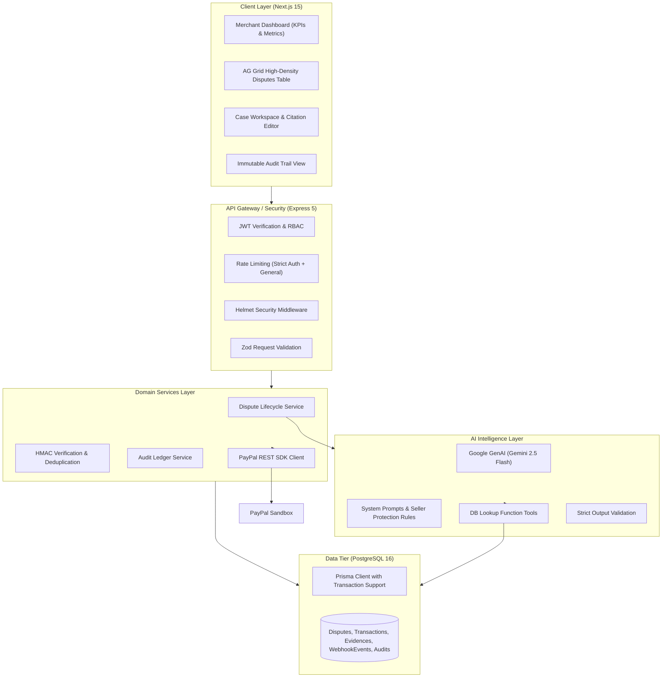

# ResolveAI Technical Architecture Specification

## 1. Executive Summary
ResolveAI is an enterprise-grade dispute intelligence and evidence automation platform designed specifically for merchants using PayPal. It bridges real-time PayPal Dispute & Order APIs with Google Gemini's structured inference models, enforcing a strict human-in-the-loop review barrier before any submission to PayPal.

## 2. System Architecture

## 3. Dispute Lifecycle State Machine

1. **DISPUTE_RECEIVED / SYNCED**:
   - Webhook arrives from PayPal (`CUSTOMER.DISPUTE.CREATED`).
   - Signature verified via PayPal REST endpoint.
   - Deduped via unique constraint on `paypalEventId`.
   - Linked to existing captured transaction in DB.

2. **INVESTIGATION & ANALYSIS**:
   - Merchant or worker triggers Gemini pipeline.
   - AI classifies reason, extracts evidence items, calculates completeness score (0-100), and flags weaknesses.
   - AI drafts response citing real transaction and tracking records.
   - Status: `PENDING_REVIEW`.

3. **MERCHANT REVIEW & APPROVAL (Hard Gate)**:
   - Merchant inspects completeness meter, verifies citations, and edits draft.
   - Merchant clicks **Approve**.
   - Status updates to `APPROVED`.
   - AI cannot proceed to submission without this step.

4. **SUBMISSION & OUTCOME**:
   - Backend calls PayPal Disputes API (`/provide-evidence`).
   - Status updates to `SUBMITTED` then `UNDER_REVIEW`.
   - Subsequent `CUSTOMER.DISPUTE.RESOLVED` webhook records outcome.
